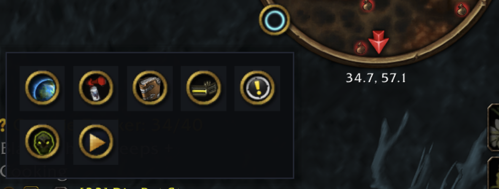

<div align="center">


**The minimap button bag for World of Warcraft.**

Halo sweeps every addon button off your minimap and tucks them into one launcher
tray. Works on Retail, WoW Forever, Classic Era and TBC Anniversary.

[Download on CurseForge](https://www.curseforge.com/wow/addons/halo)

[](https://warcraft.wiki.gg/wiki/Interface_customization)
[](https://github.com/adbergen/Halo/actions/workflows/lint.yml)
[](LICENSE)

</div>

---

<div align="center">

</div>

## Why Halo?

Every addon you install drops another little round button around your minimap until
the edge is a messy ring of icons. Halo replaces that clutter with **one** elegant
launcher. Click it and your addon buttons fan out in a clean, animated tray — the
moment you click away, they tuck themselves back out of sight.

- 🌑 **A tidy minimap** — exactly one button stays on the minimap. Everything else
  lives in the tray.
- ✨ **A modern, custom UI** — a flat dark panel with a soft shadow, accent
  highlights, and smooth fade/scale animations. No dated gold borders.
- 🧲 **Catches everything** — modern [LibDBIcon] buttons *and* hand-rolled legacy
  minimap buttons, including ones that appear after you log in.
- 🎛️ **Yours to tune** — columns, tile size, spacing, opacity, scale, click-vs-hover
  open, and a per-button opt-out, all in a clean settings panel.
- 🪶 **Lossless & safe** — opt any button back onto the minimap at any time. Halo
  only ever touches non-secure frames, so it never taints the UI.

## How it works

1. **Detect** — Halo asks LibDBIcon for its registered buttons and scans the
   minimap for legacy buttons, skipping all of Blizzard's own frames.
2. **Adopt** — each button is re-parented into the tray and pinned in place (if an
   addon tries to yank its button back, Halo gently re-seats it).
3. **Reveal** — clicking the launcher fades the tray open in a reflowing grid.

## Installation

**With an addon manager:** search for **Halo** in the CurseForge app.

**Manual**

1. Download the latest release (or clone this repo).
2. Copy the `Halo` folder into the `Interface\AddOns` folder of your game version:

   | Game version | Folder |
   | --- | --- |
   | Retail | `World of Warcraft\_retail_\Interface\AddOns` |
   | WoW Forever | `World of Warcraft\_forever_\Interface\AddOns` |
   | Classic Era | `World of Warcraft\_classic_era_\Interface\AddOns` |
   | TBC Anniversary | `World of Warcraft\_anniversary_\Interface\AddOns` |

3. Make sure the path contains `Halo\Halo.toc` directly (not `Halo\Halo\…`).
4. Restart the game.

Because the required libraries are bundled, a fresh clone runs as-is — no extra
downloads.

## Usage

| Action | Result |
| --- | --- |
| **Left-click** the launcher | Toggle the button tray |
| **Right-click** the launcher | Open settings |
| **Drag** the launcher | Reposition it around the minimap |
| `/halo` | Toggle the tray |
| `/halo config` | Open the settings panel |
| `/halo reset` | Restore default settings |
| `/halo help` | List commands |

## Settings

Open with `/halo config` or right-click the launcher.

- **Layout** — columns, tile size, spacing
- **Behavior** — open on hover, auto-hide
- **Appearance** — tray opacity, tray scale
- **Collected buttons** — uncheck any button to keep it on the minimap instead

## Project structure

```
Halo/
├── Core/        Init · Detector · Collector · Launcher  (detection + lifecycle)
├── UI/          Theme · Widgets · Flyout                (the look + the tray)
├── Config/      Options                                 (custom settings canvas)
├── Locales/     enUS                                    (localization)
├── Media/       halo-logo.tga                           (the launcher glyph)
├── Libs/        Ace3 · LibDataBroker · LibDBIcon        (embedded)
├── Tests/       mock_wow · run                          (headless CI load test)
└── docs/        listing text · screenshots              (not shipped in the zip)
```

## Development

```bash
# Lint (Lua 5.1 + WoW globals)
luacheck .

# Headless load test — loads every file under a mock WoW API and simulates a
# login, collection, the tray, slash commands, and the options panel.
lua Tests/run.lua
```

Both run automatically on every push via [GitHub Actions](.github/workflows/lint.yml).
Pushing a `v*` tag runs the [release workflow](.github/workflows/release.yml): it
builds the zip and uploads it to CurseForge, to Wago Addons (once the repository has
a `WAGO_PROJECT_ID` variable and a `WAGO_API_TOKEN` secret), and to a GitHub Release.
The text of the CurseForge and Wago pages lives in [docs/listing.md](docs/listing.md).

See [CONTRIBUTING.md](CONTRIBUTING.md) for conventions.

## Credits

Built on the shoulders of the WoW addon community: [Ace3], [LibDataBroker], and
[LibDBIcon]. Inspired by classics like MBB and MinimapButtonBag — rebuilt for a
modern look and a clean, testable codebase.

## License

[MIT](LICENSE) © 2026 Anthony Bergen. Embedded libraries retain their own licenses.

[LibDBIcon]: https://www.curseforge.com/wow/addons/libdbicon-1-0
[LibDataBroker]: https://github.com/tekkub/libdatabroker-1-1
[Ace3]: https://www.wowace.com/projects/ace3
