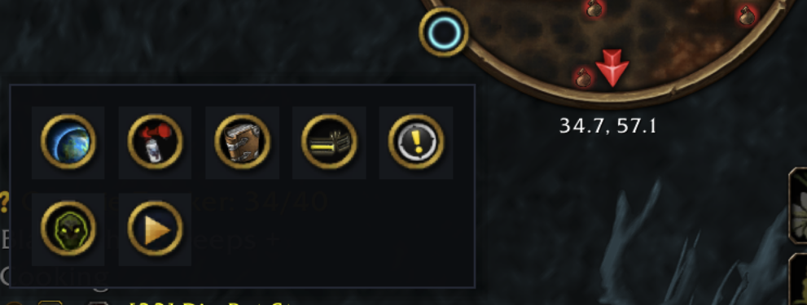

# Store listing

The text of Halo's CurseForge and Wago Addons pages. Neither site reads it from
here, so after a change, paste each field into the site by hand:

- **CurseForge:** project page → Settings. "Project name" and "Summary" are on the
  General tab, "Description" on the Description tab (choose the Markdown editor),
  and screenshots under Images.
- **Wago Addons:** project page → Edit. Same fields.

Screenshots in this folder are excluded from the release zip.

## Project name

```
Halo - Minimap Button Bag
```

The name is what search matches first. "Halo" alone matches nothing players type,
so the name carries the words they do: minimap, button, bag.

## Summary

```
Minimap button bag: gathers every addon button off your minimap into one tidy, animated tray. Retail, WoW Forever, Classic Era and TBC Anniversary.
```

## Categories

Map & Minimap (main), HUDs.

## Screenshots

1. `docs/tray-forever.png`: the tray open on WoW Forever with seven addon buttons.
2. Still wanted: a short GIF of the tray opening and closing, and the settings
   panel.

## Description

Paste everything below the line.

---



**Every addon button off your minimap, in one tray.**

Each addon you install adds another round button to the edge of your minimap.
Halo moves them all into one launcher. Click it and your buttons open in a tidy
tray; click away and they tuck back out of sight.

### Features

- **One button on the minimap.** Everything else lives in the tray.
- **Catches everything:** LibDBIcon buttons, hand-made minimap buttons, and
  buttons that appear after you log in.
- **Grid or ring layout,** with drag-to-reorder and a search box once the tray
  fills up.
- **Yours to tune:** columns, tile size, spacing, opacity, scale, open on hover,
  auto-hide, and profiles.
- **Opt any button out** to keep it on the minimap. Blizzard's mail, tracking,
  LFG and battleground buttons can be collected too.
- **Safe:** Halo only moves non-secure frames, so it never taints your UI.

### Game versions

Retail, WoW Forever, Classic Era and TBC Anniversary, from one download.

### Commands

| Command | Result |
| --- | --- |
| `/halo` | Open or close the tray |
| `/halo config` | Open settings |
| `/halo reset` | Restore default settings |
| `/halo help` | List commands |

Right-click the launcher for settings, drag it to move it around the minimap.

### Bugs and ideas

[GitHub issues](https://github.com/adbergen/Halo/issues)
